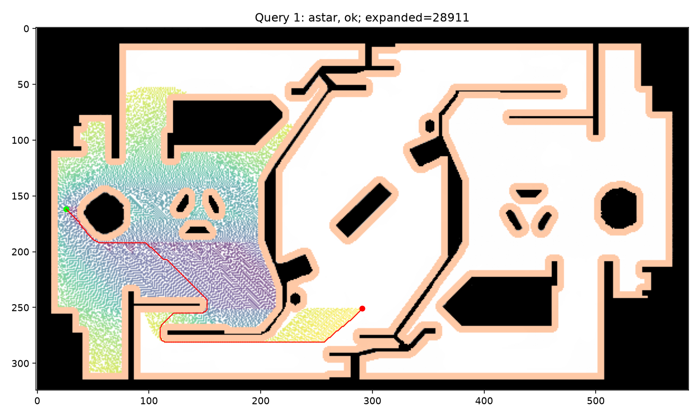
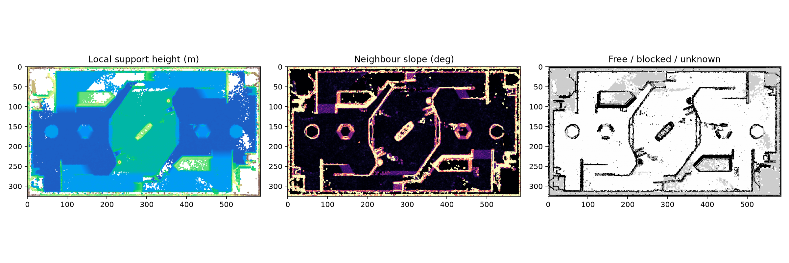

# RoboMaster视觉组招新考核：公共题与B题

考生标识：wangqi（GitHub：Api-19）。方向：**B题，环境建图与路径规划**。

本报告按2026-10-17的真实代码和运行证据整理，包含AI辅助实现，详见[AI使用记录](ai_log.md)。当前是代码与已有结果的阶段提交，真实相机采集、尺测数据和本人学习总结尚待补充，不宣称全部考核已完成。

## 一、完成情况

| 题目/要求 | 当前情况 | 证据或缺口 |
|---|---|---|
| 题一：Python与依赖 | 本机实测可运行 | [环境证据](q1_env/results/environment.json)、[实际包快照](q1_env/results/requirements-observed.txt) |
| 题一：Git管理 | 本轮上传代码与已有结果 | 此前无代码提交历史，不补造；后续持续真实提交 |
| 题一发挥：Ubuntu 22.04 | 未完成 | 只提供Linux证据采集脚本，没有安装/截图证据 |
| 题二：标定/去畸变/A4测距 | 代码完成，实拍实验待完成 | [题二说明](q2_calib/README.md)；合成测试不作为本人采集证据 |
| B：点云预处理、地面候选与调平 | 已对原始点云运行 | [点云过程图](qB_sentry/results/cloud_map/04_terrain_map.png)、[处理记录](qB_sentry/results/cloud_map/processing.json)；地形语义仍需审查 |
| B：0.05m栅格生成 | 已生成原型地图 | [栅格图](qB_sentry/results/cloud_map/map.pgm)、[配置](qB_sentry/results/cloud_map/map.yaml)，局部插值与多层限制见下文 |
| B：A*/Dijkstra与7组查询 | 已运行两种算法并给出7组结论 | 4组路径通过检查；3组端点碰撞/越界，见结果表 |
| B发挥：搜索/启发式对比 | 已运行 | [扩展数/耗时/长度](qB_sentry/results/given_map/summary.csv)、[对比图](qB_sentry/results/given_map/comparison.png) |
| B发挥：坡道/台阶 | 已实现局部高度/坡度判据 | 尚无逐格语义真值，不能认证所有坡道/台阶均分类正确 |
| B发挥：异常物体 | 统计离群已处理；语义确认待做 | 没有擅自删除猜测实体或断言成因 |
| B发挥：地图对正 | 大墙方向对正已运行 | 与给定图的绝对坐标配准尚待确认 |
| B发挥：自建图规划对比 | 工具已实现 | 尚缺本人确认的至少3组同名地标，未产生真实对比结论 |
| B发挥：决策逻辑 | 离线状态机示例已运行 | [状态转移图](qB_sentry/results/decision/state_machine.md)、[二维仿真](qB_sentry/results/decision/simulation.png)；不是实战验证 |
| 设计报告与AI记录 | 阶段报告及真实交互记录 | 本人实验分析与学习总结待补 |

## 二、仓库结构和复现

```text
README.md                 当前设计报告
RUNNING.md                完整运行说明和参数解释
ai_log.md                 真实AI协作记录，含不足与修正
requirements.txt          当前直接依赖版本
run.py                    环境/测试/规划/点云/仿真统一入口
q1_env/                   环境检查代码及本机证据
q2_calib/                 标定、采集、测距和对比代码
qB_sentry/                点云建图、搜索与决策代码，路径CSV及结果
  path1.csv ...           可达查询的默认A*路径
  results_summary.csv     7组×算法/启发式实验汇总
  results/                过程图、原始检查器日志与各算法结果
tests/                    8项算法/几何/文件流程测试
VALIDATION.md             已验证与未验证的具体边界
```

[完整运行方法与代码阅读顺序](RUNNING.md)。原始PCD、视频、虚拟环境和私人照片不进Git；运行点云/题目地图规划时，另提供原始考核材料路径。

```bash
# 使用已经具备依赖的Python 3.10+虚拟环境。
python run.py test
python run.py env
python run.py planning --data-root '/path/to/给新生 2'
python run.py cloud --data-root '/path/to/给新生 2'
python run.py decision
```

默认素材位置是当前用户的`~/Downloads/给新生 2`，可用`--data-root`覆盖。依赖版本来自实际已核验环境；Open3D的本机libusb修补尚无干净机器复现证据，不保证只安装requirements即可复现该平台问题。

## 三、方案与结果

### 3.1 题二：相机标定与单目测距

代码入口为`q2_calib/capture.py`、`calibrate.py`、`measure.py`。棋盘格实测尺寸与检测到的内角点构成3D/2D对应，标定输出K、畸变和逐图重投影RMS；去畸变输出原图对照。A4物体系原点设在纸中心，角点顺序为物理TL、TR、BR、BL，宽210mm、高297mm；先检查平面PnP候选，再用`cv2.solvePnP`细化。

K中fx、fy为像素单位的有效焦距，cx、cy为主点坐标。像素近似正方形且两轴缩放相近时fx/fy接近，不是无条件相等。重投影RMS是3D点投回图像与检测角点的像素偏差，不能单独证明测距准确。

输出同时区分`||t||`（光心到纸中心距离）与`t_z`（光轴深度），尺测参考须匹配。角点定位、纸张不平、标定姿态覆盖不足、焦距/变焦变化、尺测参考偏移等是待用本人实验量化的误差来源。

当前仅已通过已知几何与15张渲染棋盘的自动测试；**未输入本人15～25张标定照片、实测方格边长及至少5组约0.5～3m测距数据**。因此不提供伪造K、真实误差表或0°/30°/60°角度结论。

### 3.2 B题：地图与搜索

地图参数：0.05m/格，origin=(-3.58,-9.44,0)，583列×324行。图像行向下，世界y向上；世界位置含origin平移和格心偏移。未知不能直接通行。

机器人按半径0.30m圆盘处理。欧氏距离变换用于保守构造中心安全区域，并考虑占据格面积与地图边界；8邻居搜索禁止对角穿角。Dijkstra按累计代价扩展，A*增加八方向距离下界，更新更便宜的路线后回溯。均为自行实现，没有调用现成规划库。

导出保留原始查询端点，不吸附到其他空闲点；点间距不超过0.10m，严于题目0.15m上限。另以圆与方格相交检测、加大半径的线段采样覆盖连续路径，避免只检查离散点。

| 查询 | A*/Dijkstra默认导出长度（m） | 结论 |
|---|---:|---|
| 1 | 21.223688 | [path1.csv](qB_sentry/path1.csv)，检查器与独立连续底盘检查通过 |
| 2 | 27.639120 | [path2.csv](qB_sentry/path2.csv)，同上 |
| 3 | — | 起点中心虽在空闲格，圆底盘与障碍相交；不移动端点，记为无法到达 |
| 4 | 26.029322 | [path4.csv](qB_sentry/path4.csv)，检查器与独立连续底盘检查通过 |
| 5 | 57.222930 | [path5.csv](qB_sentry/path5.csv)，同上 |
| 6 | — | 终点圆底盘与障碍相交，记为无法到达 |
| 7 | — | 终点(30,3)在地图外，记为无法到达 |

原始日志：[查询1](qB_sentry/results/given_map/astar/check1.txt)、[查询2](qB_sentry/results/given_map/astar/check2.txt)、[查询4](qB_sentry/results/given_map/astar/check4.txt)、[查询5](qB_sentry/results/given_map/astar/check5.txt)。日志渲染图见[检查器输出](qB_sentry/results/checker_output.png)，它是实际日志的可视化，不冒充本人操作终端的截图。



### 3.3 B题：点云与栅格

原始2116092点→0.05m体素降采样1009274点→统计离群剔除后998900点。提取多个RANSAC候选，以与传感器z的夹角和安装高度量级先验选择地面，再将法线转到+z。首次大平面是墙，不直接作为地面；具体法线、内点数、变换矩阵在处理JSON中。

局部低分位高度估计地表，有限范围插值应对扫描稀疏；局部坡度、邻域高差和底盘高度内返回判断阻挡。超过12cm的跳变边缘不可通行，未知远区不填为空地。30°最大坡度是演示参数，题目没有提供真实最大爬坡角。

输出326×586、0.05m地图，最终运行通行125939格。该2.5D原型不能完整表示上下叠层，稀疏与插值也可能误判；需要人工审查，不能用自动生成图证明语义分类全对。对正用墙面轴方向，未自动假定与给定地图绝对坐标相同。



### 3.4 B题发挥与问题回答

1. **首次拟合是否为地面？** 不是。本数据最先得到的大平面法线与重力方向先验明显不同，结合形状判断为大墙；改为比较多个平面及安装高度/法线先验。未将AI判断伪装为本人独立发现。
2. **为何不能单一高度阈值判障碍？** 地面本身存在不同高度与坡道，传感器坐标也倾斜；全局阈值可能把高地地面判障碍，或漏掉不同地面上的矮障碍。先调平，再参考局部地面与净空/高差。
3. **检查器首次运行是否通过？** 不能编造学生首次尝试。本代码导出的4组可达路径在本轮原检查器执行时通过。早期环境核验使用了故意出界的反例并被拒绝，不是学生首次规划。原脚本失败也可能退出码0，且只逐点检查，因此额外读取实际“通过”输出并校验连续底盘和边界。
4. **曼哈顿与权重2有何影响？** 八邻居允许斜走时曼哈顿可能高估代价，权重2也可能破坏最优保证。本图实验路径相同不证明其他地图仍最优；扩展数/单次耗时见汇总表，不夸大稳定性能结论。
5. **地图参数含义？** resolution为米/格；origin为地图左下参考在世界中的平移与朝向；occupied/free阈值用来解释占据程度，二者之间为未知。本题negate=0，黑色占据程度高。程序以检查器的严格小于free阈值判通行，不把不同库的等号边界混用。
6. **状态机/行为树和LLM？** 少量明确状态适合状态机，组合和复用任务可用行为树。LLM可辅助高层意图解释，但延迟、不确定性和错误状态推断需受确定性边界约束。本仓库只提供离线移动仿真，不连接真实执行机构。

地图配准比较工具需至少3个非共线同名地标；目前没有真实地标输入，所以不报告自建图与给定图路径差异。统计离群点已处理，但“场地中不应存在的实体”尚缺语义确认；没有凭外观删除实体或编造成因。

## 四、问题记录与验证

- Open3D加载修补由Claude辅助完成，Codex验证本机可导入/读点云；未重演安装过程，详见AI记录。
- 点云首版要求过多直接观测支持导致地图碎片，检查过程图后改为有限局部地面支持插值，保留实际观测标记和局限。
- 缓存标定对比曾因numpy整数无法JSON序列化失败，改为Python int后全量测试通过。
- **8项测试通过**，见[具体验证](VALIDATION.md)与[测试输出](tests/last-run.txt)。合成图和已知几何仅验证算法/文件流程，不替代本人相机实验或未公开数据。

## 五、本人学习总结与后续

**待本人阅读代码、完成真实实验后用自己的语言填写。** 本节不由AI代写成“我已经掌握”。当前未有独立完成全部算法或无AI现场修改的证据。

后续重点：补真实相机标定/尺测与实拍图表；核查地形和异常实体；确认地图地标后做配准对比；练习讲解与修改关键代码；持续真实提交。截止时间按本人确认的北京时间2026-10-19 23:59。
