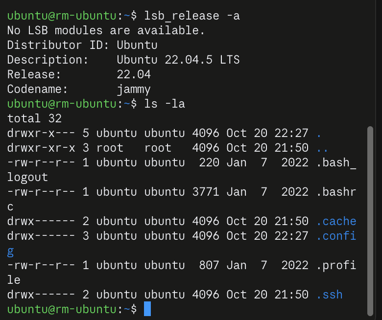
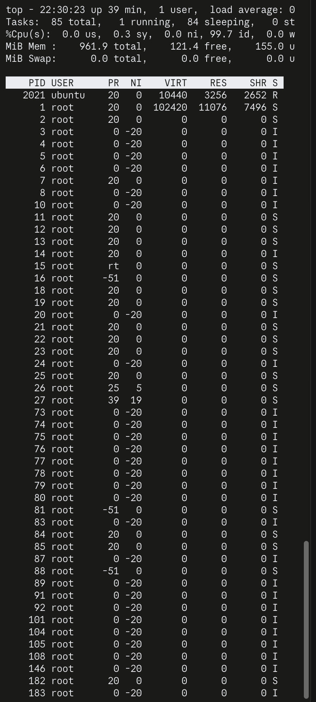
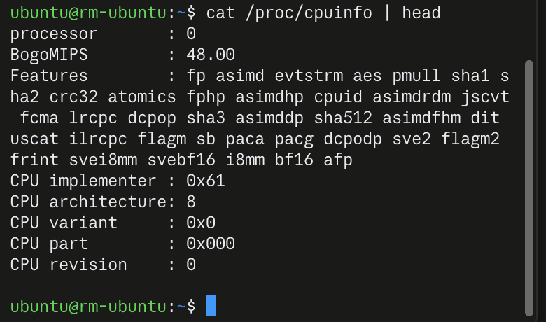

# 题一：开发环境

## 基本要求

- Python 3.11.17（uv 安装），依赖：numpy、opencv-python、matplotlib、pyyaml、open3d、scipy。
- `results/environment.json`：依赖导入检查结果；`results/requirements-observed.txt`：实际安装的包版本。
- `check_environment.py`：重新生成上面的检查结果。
- Open3D 在本机缺少 libusb 动态库，修改了它的依赖路径后才能导入，所以只靠 `requirements.txt` 不能在别的机器上完全复现（见 [AI 使用记录](../ai_log.md)）。

## 发挥部分：Ubuntu 22.04

在 Mac（Apple Silicon）上用 Multipass 创建了 Ubuntu 22.04.5 LTS 虚拟机（ARM64，1 核、1 GB 内存）。

安装过程中遇到的问题：

1. `multipass launch` 第一次报错 `Remote "release" is unknown or unreachable`：官方镜像服务器响应慢，第一次请求超时。用 `multipass find --force-update` 刷新镜像列表后，加上 `--timeout 1200` 重新创建成功。
2. `multipass shell` 报错 `No route to host`：虚拟机正常运行，但 Multipass 的后台服务被 macOS 的"本地网络"权限拦截。改为用 Multipass 的密钥直接 `ssh` 登录虚拟机。

截图：

| 命令 | 截图 |
|---|---|
| `lsb_release -a`、`ls -la` |  |
| `top` |  |
| `cat /proc/cpuinfo \| head` |  |

`/proc/cpuinfo` 中 `CPU architecture: 8` 表示 ARMv8 架构，因为虚拟机运行在 Apple Silicon 上。
